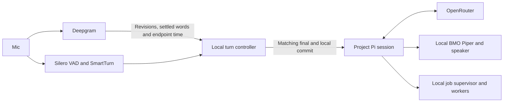
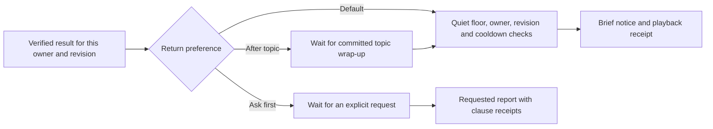

# Architecture review

### D1 · Local BMO voice session

During a Deepgram turn the controller allows a short gap for a second clause.
If SmartTurn holds the floor, a full second of local quiet can corroborate a
settled sentence. The settled words must cover the last speech and match the
current transcript. A closed sentence has terminal punctuation or a matching
provider endpoint with a non-dangling word ending. Resumed speech restarts the
quiet interval. A late change to the final prevents dispatch on this path.
The loopback routing test uses a fresh draft-only supervisor store. Live mic
authorization, spoken approvals and ordinary course playback retain their
existing gates.

### D2 · Integrated result-return policy

The foreground can change a return preference while a job runs. The delivery
controller checks it again before playback. Revising the job starts a new
delivery record. The earlier candidate and benchmark notes below describe the
behavior at their dated revisions.

