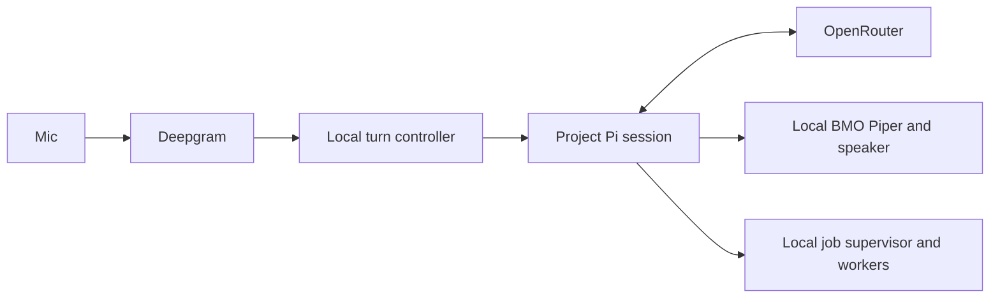
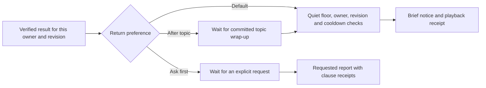

# Architecture review

### D1 · Local BMO voice session

### D2 · Integrated result-return policy

The foreground can change a return preference while a job runs. The delivery
controller checks it again before playback. Revising the job starts a new
delivery record. The earlier candidate and benchmark notes below describe the
behavior at their dated revisions.

