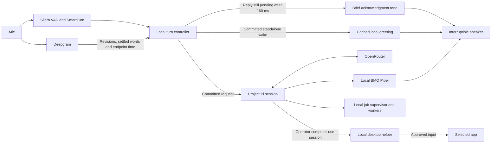
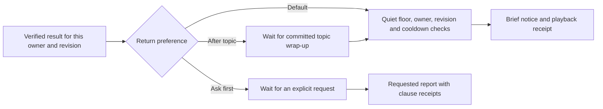
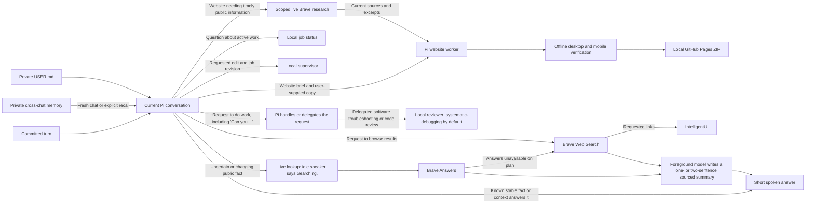
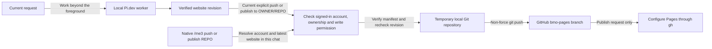
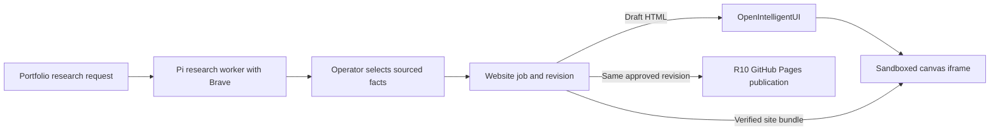

# Architecture review

### D1 · Local BMO voice session

Deepgram proposes segment ends after 250 ms of quiet. A standalone wake can
use a matching segment final after 240 ms of local quiet. A completed question
can use it after 400 ms with SmartTurn confirmation. The segment must cover
the latest voiced frames, including any resumed speech. Other complete turns
retain the grace period for a second clause and can request a provider flush.
While the user speaks, the client opens one standby ASR connection. Only
the active connection receives audio. The standby takes over after the prior
turn has finished or been discarded. We trim
leading quiet from greetings and keep the local voice warm for spoken answers.
The 85 ms acknowledgment uses the same speaker and yields to resumed speech
or an available reply. Mid-clause speech cues require explicit overlap mode.

If SmartTurn holds the floor, a full second of local quiet can corroborate a
settled sentence. The settled words must cover the last speech and match the
current transcript. A closed sentence has terminal punctuation or a matching
provider endpoint with a non-dangling word ending. Resumed speech restarts the
quiet interval. A late change to the final prevents dispatch on this path.
The loopback routing test uses a fresh draft-only supervisor store. Live mic
authorization, spoken approvals and ordinary course playback retain their
existing gates.

### D2 · Integrated result-return policy

The foreground can change a return preference while a job runs. The delivery
controller checks it again before playback. Revising the job starts a new
delivery record. The earlier candidate and benchmark notes below describe the
behavior at their dated revisions.

### D3 · Continue the conversation or steer a job

Pi can use public evidence from the current and preceding two exchanges. Older
chats supply context on request. A normal follow-up uses the conversation already
on the current branch. Edits carry the existing job ID and expected revision.
A new revision retains outstanding notification intent and runs under the same
supervisor. Selected portfolio facts still use the publication review flow.
After a lookup, the host voices the model’s lead summary, not a pointer to Pi.
Requested links stay in IntelligentUI. If the search cannot verify the answer,
BMO says so aloud.

### D3 / R10 · Implemented Pi handoff and GitHub Pages publication

On the BMO working tree based on `6b6bf3c`, a completed website has a local ZIP.
R10 adds a public destination for an explicitly selected revision.

The explicit, destination-bound request is the authorization for an account-owned
push. There is no second terminal or web dialog. The host checks `gh api user`
and the canonical writable repository; login alone never triggers a push. Workers
cannot upload files. Only the verified site snapshot goes into Git, not the
project worktree. Plain push leaves Pages settings alone; publishing also sets
its source. An unchanged snapshot reuses its commit.

### D3 / R11 · Implemented live website canvas

