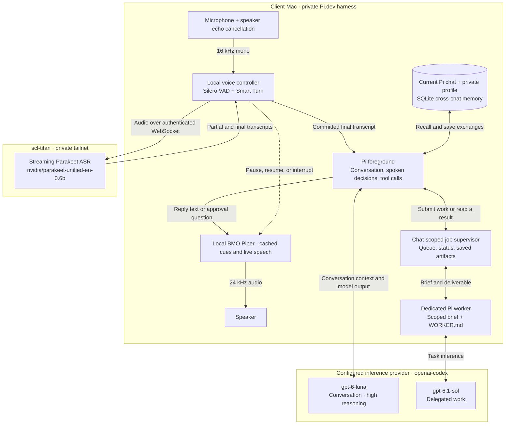

# Pi.dev voice on the Mac

ME3 is a hands-free coworker and secretary. Talk through a decision, ask for a draft, or pick up a conversation from yesterday. Start Pi with the configured client login in the voicechat-trial ME3 checkout.

```sh
bash integrations/voicechat/start.sh
```

The default voice for this pilot is BMO Piper. The launcher verifies the two pinned release files and prepares eight clips on first use. Subsequent launches reuse the cache. Edit the phrases in `integrations/voicechat/behavior/phrases.json` and rerun setup or relaunch to bake the edited phrases. Set `ME3_VOICE_TTS=lessac` or `kokoro` to select a previously installed voice. BMO's upstream describes the voice as a non-commercial fan project. Piper runs on the host CPU, including the planned Hailo-8 deployment. [BMO voice release](https://github.com/brenpoly/be-more-agent/releases/tag/v1.0-voice)

The interactive launcher opens one project window. Click **Toggle mic** or enter **`/me3 duplex`** in Pi to toggle voice. A fresh Pi process loads the migrated extension. The ready status names the active ASR and voice. Talk normally. The mic meter shows the current partial hypothesis. The transcript widget shows the final wording, and a committed turn appears in the Pi conversation. A committed request to build a local website goes directly to the project’s Pi worker. You can also type the request. To require a separate spoken confirmation for each local build, set `ME3_CONFIRM_LOCAL_SITE=1` before starting Pi. In that profile an approval expires after 45 seconds. This pilot uses the existing trusted-room microphone boundary.

Pi asks ordinary preference questions in its own words and uses your next committed turn as the answer. During a longer unfinished thought, you may hear one cached listening cue in a gap. When you resume, the cue gives way and both parts stay in the same turn. The cue cannot answer a pending approval.

Cross-chat memory is on by default for saved Pi chats. Ask “Where did we leave off?” in a new chat, or launch with `--continue` to reopen the most recent thread with its full Pi history. Enter `/me3 memory` to check the current session. Set `ME3_MEMORY_ENABLED=0` before launch to pause both cross-chat reads and writes. An unsaved `--no-session` chat and an audio fixture also skip both.

The trusted local profile holds up to 256 exchanges in `conversation.sqlite3` alongside USER.md. Each exchange keeps up to 1,000 characters per side. Typed answers are saved on completion. Voice answers require a matching speaker playback receipt. The foreground model can receive up to three previous exchanges selected by keyword overlap and recency. Its own Pi thread supplies the current conversation. Workers receive their scoped briefs. Earlier chat excerpts cannot approve a new action. Use a separate `ME3_VOICE_PROMPT_DIR` for another operator. The OS user and profile select this pilot's memory; it has no speaker-based identity check. With the demo closed, removing that database clears cross-chat recall. Pi chat files remain separately manageable.

The launcher sources the common checkout’s private `.env`. The ASR client reads `ME3_ASR_TOKEN` there or from the process environment, with a mode-600 `.local/parakeet.token` in the voicechat-trial checkout as a local alternative. Its connection uses normal certificate verification and bearer authentication at `wss://speech.example.invalid:8443/v1/asr/stream`. Receiving the version-1 Parakeet ready event establishes readiness. HTTP 401/403 errors end startup and appear in Pi.

The Mac callback pairs 24 kHz mono capture with the actual speaker render reference for echo suppression. A stateful resampler produces 20 ms, 640-byte frames at 16 kHz. Silero detects local speech and can pause current playback. Smart Turn proposes an endpoint. An unfinished phrase or a lagging streaming transcript can briefly extend the listening window. A short local listening cue can play in a story pause while the speaker keeps the floor. The authenticated socket reader runs concurrently with upload and replaces partials by revision. Only a matching final and local commit can enqueue a Pi turn. Empty finals and positive backchannels during playback release the provisional pause. Local BMO Piper speaks the settled Pi answer through the Mac speaker. While an approved tool is running, another voice turn can interrupt speech without aborting that tool.

Transport errors and server overflow abandon the current utterance. The live launcher retries transient faults up to twice per minute with backoff, rechecks readiness and waits for quiet before accepting new input. It never replays an unfinished utterance. An idle connection can close and reopen on the next utterance. Normal shutdown releases the socket, audio device, analyzer and synthesis process. Routine diagnostics record timings, not microphone PCM.

By default the Mac uses the system’s selected audio devices. For a device-specific test only, set `ME3_MIC_DEVICE_INDEX` and `ME3_SPEAKER_DEVICE_INDEX` to the current PortAudio indices before launching. Indices can change when devices reconnect.

## Current Mac architecture

### One project window

The left pane runs the project’s Pi terminal. **Canvas** on the right renders streamed HTML and dashboard rows. **Agents** shows each local worker’s status, partial draft and final text. Say “show my agents” to change panels hands-free. A background update leaves the current panel in place.

Try “Show me how to solve 2x + 3 = 11, one step at a time,” then “Why subtract three?” or “Continue.” For a design, try “Sketch an invitation in warm colors,” then “Make the date larger.” For schedules, tell Pi the events or connect a calendar tool. This voice profile has no calendar connector.

Interactive startup uses the project-local Pi installation and opens a single loopback app window on the Mac. A second launch prints the existing address. Closing the window allows 15 seconds for a reload, then stops that Pi process and microphone. Use `--terminal` for a plain terminal session or `--window` to select the window explicitly. When using the benchmark, put `--live-benchmark` first. The launcher installs the pinned local browser assets on first use. All generated pages use the bundled OpenIntelligentUI partial-HTML renderer, a sandboxed iframe and local math rendering.

### A personal dashboard you can use by voice

With duplex on, ask for a plan, a comparison or a checklist. For example, say “Help me plan the workshop. We have Monday or Thursday, and we need to reserve the room and send invitations.” Pi can draw the choices and tasks in Canvas as the model generates them. Then say “Choose Thursday and check off reserving the room.” You can also ask Pi to change a row or read back what is open. Ordinary conversation can continue with the board visible.

Selecting or checking a row updates your plan. To have Pi draft the invitation or do other work, ask for that action. Reopening the same saved Pi chat restores its most recent confirmed dashboard. The native widget follows the task-specific choices and checklists in [OpenIntelligentUI’s interactive answer examples](https://github.com/CopilotKit/OpenIntelligentUI/blob/main/docs/interactive-answers.md).

### Live human-command benchmark

From this worktree, run `bash integrations/voicechat/start.sh --live-benchmark` and enter `/me3 duplex`. This separate profile sends 16 kHz mono speech to Deepgram Nova-3 and uses DeepSeek V4.1 Flash for both Pi roles. On every request, the Pi extension pins the October 17 snapshot with Nitro routing to Nebius FP4 and disables provider fallback. The automated class launcher selects the same DeepSeek route and pinned BMO Piper voice. The interactive benchmark uses the operator’s voice profile and cross-chat memory. The automated course runner uses separate blank templates with memory disabled. The ordinary launcher still selects the regular pilot.

The live DeepSeek foreground defaults to thinking off and explicitly requests zero reasoning. The delegated Pi worker defaults to high reasoning. Set `ME3_FOREGROUND_THINKING` or `ME3_WORKER_THINKING` to change the corresponding role. Ask a private identity question to test the profile and `/me3 memory` to inspect recall status. For a public question, try “Search the web for the latest stable Python release.” The Brave tool returns dated retrieval details and source links. If Brave reports that the configured plan excludes the Answers option, Pi uses Brave Web Search for the same question and identifies that route in the receipt.

To try the routing aloud, summarize a note you supply, then ask a question whose answer changes. Pi can answer the first from the conversation and call Brave for the second. After the lookup, the foreground model reads the evidence and writes a short spoken takeaway. Tool replies are limited to two complete sentences and 45 words at the speaker. Simple math is verbalized. Full sources, formatted artifacts and in-progress previews stay available in Pi. “Give me the short version” reuses that evidence. The terminal retains Markdown and sources. Piper and Kokoro receive the speech-formatted answer.

The launcher reads `DEEPGRAM_API_KEY` and `OPENROUTER_API_KEY` from the client environment or the private `.local/benchmark.env`. For the historical `ME3_VOICE_TTS=lessac` profile, install the [Lessac Medium INT8 bundle](https://github.com/k2-fsa/sherpa-onnx/releases/download/tts-models/vits-piper-en_US-lessac-medium-int8.tar.bz2) under `.local/models/`. Its published SHA-256 is `f1c6d0295cf16087b05f80fdca5b44daca5cd78e2c425d419a42ba34929805f9`. The voice runs locally on CPU. [Hailo's platform guidance](https://github.com/hailo-ai/hailo-apps/blob/main/.hailo/agents/hl-voice-builder.md) likewise uses Piper on the CPU of a Hailo-8 system.

Give a command, listen, then enter `/me3 rate 4 reason` before your next command. Use 5 for accurate, natural and usable as spoken, 3 for a useful answer needing correction, and 1 for a missed or unusable answer. `/me3 results` shows the counts, mean latency for measured replies and average of the human ratings. Try a meeting handoff, a mid-answer correction and a delegated draft followed by a status check. Operators can use their own words.

Each run writes a private JSONL under `.local/live-bench/` with committed transcripts, reply text, tool outcomes, model timing, first output and ratings. End-to-end timing uses the first locally quiet VAD frame of the committed turn and the first non-silent reply callback on the Mac monotonic clock. Callback time is a software output measurement. The first spoken approval question counts as a response. Listening cues do not. Discarded input has its own event, and a committed command with no matching output remains in the denominator.

### Regular Mac pilot



The Pi terminal shows microphone level, partial and final transcripts, and delegated job progress. Only a committed turn enters the conversation. A new turn can interrupt foreground speech while a submitted job continues. The selected voice receives the conversational reply once Pi settles. A matching playback receipt makes the spoken reply eligible for cross-chat memory.

## Edit the voice prompt

You can start talking as soon as the configured audio and inference services are ready. Pi receives the enabled tools and their descriptions directly from the extension, and the dedicated worker ships with its own task instructions. Personalization is optional.

On first launch, Pi creates missing files under `.local/voice-prompts/` from the [editable templates](../integrations/voicechat/templates/). Open USER.md and type after the **Preferred name**, **City or region**, or **Time zone** label. Open SOUL.md for **Tone** and **Usual reply length**. Fill only the rows you care about. Each answer can be a word or a sentence. Blank rows, group headings and the editing guide add no model instructions. You can also put ordinary Markdown notes below the form. Pi picks up foreground edits on the next turn and worker edits on the next job. Existing operator files take precedence over template installation.

| File | What to put there |
| --- | --- |
| `SYSTEM.md` | How the agent should work, clarify requests and handle decisions. Add any personal routing preferences here. |
| `SOUL.md` | How it sounds. For example, “Give me the answer first. Pause before offering more detail.” |
| `USER.md` | Details you choose to share, such as your preferred name, pronunciation, project vocabulary or response preferences. |
| `WORKER.md` | Extra instructions for delegated deliverables, including style, evidence and handback format. |

The tracked defaults for SYSTEM.md, SOUL.md and WORKER.md live in `integrations/voicechat/prompts/`. Edit a default to replace its wording for the project. Use the private files to add your own guidance after the corresponding defaults. Each file accepts up to 8 KiB of Markdown. Empty private files add nothing. Set `ME3_VOICE_PROMPT_DIR` before launching to use a different private folder.

The default private folder is Git-ignored. SYSTEM.md, SOUL.md and USER.md feed the foreground model. A private USERS.md alongside USER.md also feeds the foreground. If an older profile contains TOOLS.md, its personal instructions still load. WORKER.md feeds the delegated model. Keep credentials in the operator environment. Clearing a file removes it from future prompt assembly. Pi’s existing chat history is separate.

### How the templates were chosen

ME3 uses the distinction Pi makes between a base system prompt and appended instructions. A new operator gets the complete product behavior on first launch. Edits add preferences in one place. [Pi 0.84.2 prompt customization](https://github.com/earendil-works/pi/blob/v0.84.2/packages/coding-agent/README.md#system-prompt)

The SOUL template covers conversational manner. USER holds facts or preferences someone chooses to supply. Each example in ME3 is a writing aid in an editor-only comment, so an untouched profile supplies no name, personal facts or sample requests. [OpenClaw SOUL template](https://docs.openclaw.ai/reference/templates/SOUL) · [OpenClaw USER template](https://docs.openclaw.ai/reference/templates/USER)

The WORKER template describes the deliverable and what counts as usable, giving the foreground agent a result it can bring back to the conversation. [Anthropic on orchestrator–worker design](https://www.anthropic.com/research/building-effective-agents)

### Why these starter prompts are written for speech

SOUL.md puts the decision question at the end of a turn so the listener has a clear place to answer. SYSTEM.md tells Pi how to interpret corrections in a committed transcript. The audio controller already handles pauses and listening cues. Asking Luna to insert filler into its text would make the voice speak it when the answer plays. [Google’s guide to spoken questions](https://developers.google.com/assistant/conversation-design/questions) · [Pipecat Smart Turn](https://github.com/pipecat-ai/smart-turn)

Each registered tool describes its own purpose and arguments. A read can return a fact directly. The local site tool submits a draft on request. The operator can enable separate spoken confirmation. This applies voice prompting guidance on short answers, ambiguity and tool-specific confirmation to the Pi pilot. [OpenAI’s voice prompting guide](https://developers.openai.com/api/docs/guides/voice-prompting)

## Delegate work to the private ME3 Pi worker

Say “Delegate a comparison of blinds and curtains for a reading room.” Pi returns a job ID after local storage accepts the brief. The terminal shows draft progress while you keep talking. Ask “What did the worker find?” to read the saved result. Ask for a website with the content you want. Pi submits the local build and reports the confirmed status. Only the host validates and writes the generated files.

The launcher installs and uses Pi 0.84.2 under `integrations/voicechat/node_modules/`. The foreground keeps its existing ME3 login and chat store in the client checkout’s `.local/pi/`. The delegated SDK uses its own agent directory under this checkout’s `.local/voice-worker/agent/`. Each revision has a separate Pi session alongside its artifact. The worker reads provider authentication through the ME3 project's credential store. It receives the scoped brief plus the shipped and private WORKER.md instructions. It starts with zero enabled tools and has no playback channel. Configure its inference with `ME3_WORKER_PROVIDER` and `ME3_WORKER_MODEL`. For an environment-based provider key, `ME3_WORKER_API_KEY_ENV` names the specific variable to forward.

Each Pi chat has a durable queue with one active job, four waiting slots and a 600-second job deadline. Muting the mic leaves the supervisor running. Exiting or reloading Pi interrupts unfinished work. Reopening that same chat restores its recorded job status and any completed artifacts. Ordinary Pi sessions elsewhere keep their own configuration.

## Reproduce the transport check

Use the launcher’s installed Python environment, the provisioned ASR token, and two distinct mono PCM16 speech WAVs. This runner exercises binary upload, intermediate partials, explicit cancel acknowledgment, a new utterance, silence, and disconnect during speech followed by a fresh handshake. The JSON report contains transcripts of the supplied fixtures and timings from the Mac’s monotonic clock.

```sh
python -m me3.parakeet_smoke --audio meeting.wav --second-audio timer.wav --report mac-smoke.json
```

The first-partial interval starts at the first audio frame sent. End-to-final starts at the client end message. Neither includes the time spent deciding to end the turn. Physical interruption and speaker-stop latency require a separate acoustic measurement.

Set `ME3_PARAKEET_URL` to your authenticated speech server WebSocket URL when selecting Parakeet.
